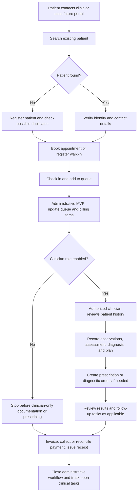
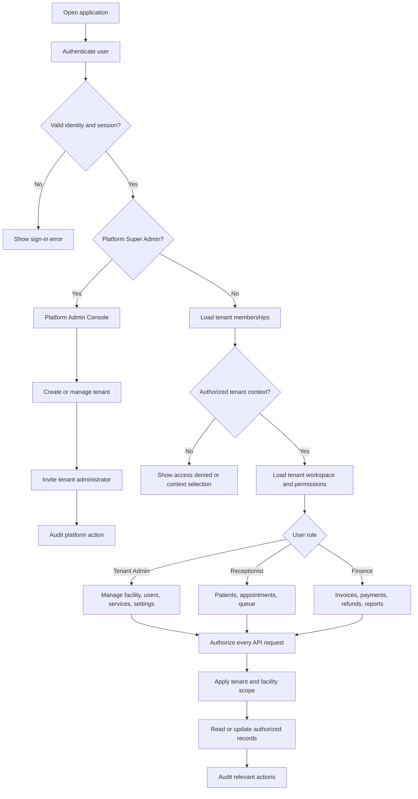
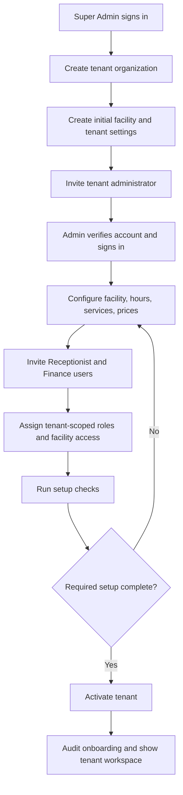
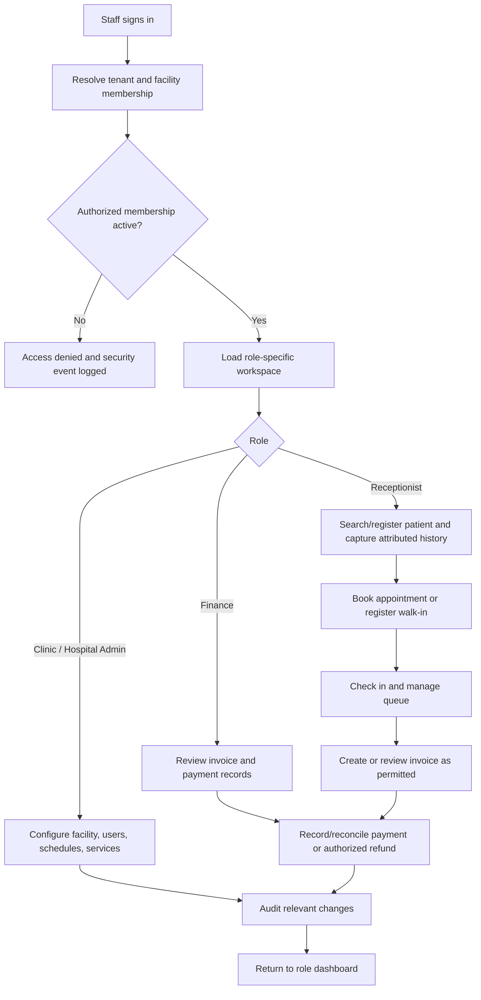
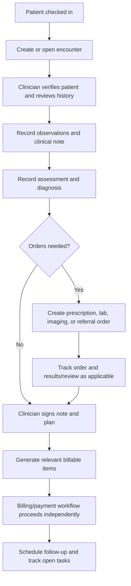

# Clinic Management Platform — Product Requirements, Features, Workflows, and Hospital-Ready Architecture

> **Review update:** This document has been reviewed for scope consistency, multi-tenant security, role boundaries, patient-history integrity, and the clinic-to-hospital roadmap. See Sections 20–21 for review outcomes and the consolidated application flow.

## 1. Product Vision

Build a healthcare management platform that launches with outpatient clinics and can later expand into a hospital management system without requiring a complete rewrite.

The long-term product should support the complete outpatient journey: patient registration, appointments, check-in, queue management, consultation, prescriptions, diagnostic orders, billing, and follow-up care. The initial release is narrower: four staff roles for administration, patient-reported history, appointments/queues, and finance. Signed clinical workflows require a later clinician-role gate.

### Product strategy

- **Start with clinics:** Deliver a focused, commercially useful MVP for general practice and other outpatient clinics.
- **Design for expansion:** Establish reusable healthcare foundations for organizations, facilities, locations, users, patients, encounters, clinical records, orders, billing, and audit.
- **Add hospital capabilities incrementally:** Introduce departments, wards, beds, admissions, inpatient encounters, nursing workflows, operating theatres, and other hospital modules as separate capabilities.
- **Avoid premature complexity:** Do not build every hospital workflow in the first release. Make the initial data model and module boundaries extensible.

### Applications Across the Roadmap

- **Initial staff web application:** Super Admin console plus tenant workspaces for Clinic / Hospital Admin, Receptionist, and Finance.
- **Later clinician workspace:** Doctor / Practitioner and additional clinical roles, enabled only after their permissions and clinical audit flows are implemented.
- **Later patient portal / mobile app:** Appointment management, authorized records, invoices, and follow-ups, using a separate patient identity model.
- **REST API:** Integrations with payment gateways, notification providers, laboratories, and third-party systems as each integration is prioritized.

## 2. Product Scope by Release

| Capability | Clinic MVP | Later hospital expansion |
|---|---|---|
| Organization and facility management | Clinic and branches | Hospitals, campuses, facilities, buildings, floors, departments, units |
| Patient management | Registration, demographics, patient-reported history, documents | Enterprise-wide patient identity, record-linkage, and medical record number policies |
| Scheduling | Doctor appointments and walk-ins | Outpatient, inpatient-related scheduling, procedures, theatre and equipment scheduling |
| Clinical records | Patient-reported history only until clinician-role gate; then outpatient encounters | Inpatient encounters, nursing documentation, care plans, multidisciplinary notes |
| Queue management | Reception and consultation queue | Department queues and service-point workflows |
| Prescriptions | Deferred until authorized clinician role is enabled | Inpatient medication orders, medication administration records, formulary controls |
| Diagnostics | Lab orders and results in later MVP phase | High-volume lab, radiology, imaging workflow and integration |
| Billing | Service invoices, payments, receipts, and refunds; consultation billing when clinical workflows are enabled | Outpatient/inpatient billing, packages, payer contracts, insurance claims |
| Inventory | Optional basic pharmacy stock | Pharmacy, medical supplies, stores, procurement, batch and expiry tracking |
| Bed management | Not required | Beds, rooms, wards, occupancy, cleaning and transfers |
| Admissions and discharge | Not required | Admission, transfer, discharge, discharge summary |
| Operating theatre | Not required | Theatre scheduling, procedure records, perioperative workflow |
| Reporting | Clinic operational and financial reports | Hospital-wide capacity, occupancy, clinical operations, revenue and quality reporting |

## 3. User Roles Across the Product Roadmap

The roles below describe the broader product direction, not all roles in the first release. The **initial release has exactly four staff role profiles**: Super Admin, Clinic / Hospital Admin (tenant administrator), Receptionist, and Finance. Doctor, nurse, lab, pharmacy, and patient-portal access are future role expansions unless the release scope is explicitly changed. See Sections 18–21 for the initial access model and the clinical-safety implications of this decision.

### Clinic Owner / Organization Administrator
- Manage organization profile, facilities, branches, departments, services, prices, and schedules.
- Manage staff, roles, permissions, and access policies.
- View operational, workflow, and financial reports.
- Configure notification templates and organization policies.

### Receptionist
- Register and search patients.
- Book, reschedule, and cancel appointments.
- Register walk-in patients.
- Check patients in and manage waiting queues.
- Update demographic information within permitted limits.

### Doctor
- View appointments and waiting patients.
- Review medical history, allergies, medications, and prior visits.
- Record vitals, symptoms, examinations, diagnoses, and treatment plans.
- Create prescriptions, laboratory orders, referrals, and follow-up plans.
- Sign and finalize consultation notes.

### Nurse / Clinical Assistant
- Record vitals and intake information.
- Prepare patients for consultation.
- Assist with specimen collection and clinical workflows according to permissions.

### Cashier / Billing Staff
- Generate and review invoices.
- Record payments, partial payments, and refunds.
- Issue receipts and reconcile daily collections.

### Lab Staff
- View laboratory orders.
- Track specimens and test processing.
- Enter results and submit them for review.

### Pharmacist / Dispensing Staff (Optional)
- Review prescriptions and record dispensing.
- Manage medication stock and expiry dates if the clinic operates a pharmacy.

### Patient
- Register and manage profile details.
- Book, reschedule, and cancel appointments.
- Complete intake forms.
- View authorized prescriptions, results, invoices, and medical records.
- Receive reminders and manage follow-ups.
- Manage dependents where verified authorization is supported.

### Future Hospital Roles
- Hospital administrator and department manager.
- Admissions and discharge staff.
- Ward nurse and charge nurse.
- Bed manager.
- Inpatient doctor / consultant.
- Operating theatre and procedure staff.
- Radiology and laboratory staff.
- Hospital pharmacist and medication administration staff.
- Insurance and claims officer.
- Medical records officer.
- Procurement, inventory, and facilities staff.

Roles should be configurable through permissions rather than hard-coded assumptions about job titles.

## 4. Feature List

### 4.1 Organization, Facility, and Branch Management — Foundation

- Create an organization / tenant.
- Support multiple facilities under one organization.
- Configure each facility's type, address, timezone, contact details, operating hours, and local settings.
- Support clinic branches at launch.
- Model departments and service locations as reusable concepts.
- Support future hospitals, campuses, buildings, floors, wards, rooms, and beds without requiring these features in the MVP.
- Configure services, doctors, consultation rooms, pricing, and schedules by facility.
- Allow authorized users to work across multiple facilities.
- Scope records and permissions by organization and, where applicable, facility.

### 4.2 Patient Management — Clinic MVP

- Patient registration with a unique patient identifier.
- Demographics: name, date of birth, contact details, address, and emergency contact.
- Search by name, patient ID, phone number, or other permitted identifiers.
- Duplicate detection using configurable matching rules.
- Medical history, allergies, chronic conditions, and prior surgeries.
- Current medications and family history.
- Visit history, diagnoses, prescriptions, laboratory results, and uploaded documents.
- For every history entry, capture source (patient-reported, imported, or clinician-recorded), author, recorded date, verification/review status, and amendment history where applicable.
- Distinguish “not assessed”, “unknown”, “patient reports none”, and “clinician-confirmed none”; never treat missing data as a negative finding.
- Patient consent and privacy preferences.
- Upload reports, scans, referral letters, and other attachments.
- Merge duplicate records with a traceable audit history.
- Record dependents and authorized representatives where applicable.

**Hospital-readiness requirement:** Separate the long-lived patient identity from individual visits or encounters. A patient may visit multiple facilities and have many outpatient or inpatient encounters over time.

### 4.3 Appointment and Queue Management — Clinic MVP

- Doctor calendars, working hours, leave, and holidays.
- Appointment booking, rescheduling, and cancellation.
- Appointment types, durations, fees, and available slots.
- Walk-in registration.
- Check-in and queue ticket generation.
- Queue statuses: waiting, called, in consultation, completed, and missed.
- Waiting-room queue display and estimated waiting time.
- Appointment reminders through configured channels.
- Follow-up appointment scheduling.
- Configurable buffer times and prevention of double booking.
- Cancellation and no-show policies.
- Optional recurring appointments.

**Hospital expansion:** Extend scheduling to departments, procedures, diagnostic services, operating theatres, equipment, and inpatient-related appointments.

### 4.4 Consultation and Electronic Medical Records (EMR) — Clinical Release (Requires a Clinician Role)

- Doctor dashboard showing today's appointments and waiting patients.
- Patient timeline and previous consultation notes.
- Vitals such as blood pressure, pulse, temperature, weight, and height.
- Presenting complaint and history of present illness.
- Clinical examination notes.
- Diagnosis selection and clinical coding where applicable.
- Treatment plan and follow-up recommendations.
- Prescription creation.
- Laboratory, imaging, and referral orders.
- Reusable clinical note templates.
- Save draft, sign, and finalize consultation.
- Addenda for correcting or supplementing signed notes without silently overwriting the original.
- Validation of required fields before signing.
- Configurable alerts for critical findings.

**Release gate:** The four-role administrative MVP must not allow a Receptionist, Finance user, or non-clinical tenant administrator to author, sign, or finalize clinician-only records. Signed clinical notes, diagnoses, prescriptions, and clinical orders require an authorized practitioner identity and appropriate professional permissions. Add a Doctor / Practitioner role before enabling these workflows for real clinical use. Until then, the patient registry may capture clearly labeled patient-reported history and upload documents, but must not present that information as clinician-verified advice or diagnosis.

**Hospital expansion:** Add inpatient progress notes, nursing notes, care plans, handover, multidisciplinary documentation, discharge summaries, and observation charts.

### 4.5 Prescription and Medication Management — Clinical Release (Requires a Clinician Role)

- Medication catalogue with generic and brand names.
- Dosage, frequency, route, duration, and quantity.
- Allergy and interaction alerts where reliable reference data is available.
- Prescription preview, printing, and secure digital sharing.
- Prescription history and refill requests.
- Dispensing status where the clinic handles medication dispensing.
- Optional stock management, batch tracking, and expiry alerts.

**Hospital expansion:** Add inpatient medication orders, medication administration records, medication reconciliation, formulary controls, pharmacy verification, and unit-dose workflows where required.

### 4.6 Billing and Payments — Clinic MVP

- Consultation fees and service price lists.
- Invoice generation from configured services in the administrative MVP; link consultation and ordered-service charges after the clinical module is enabled.
- Discounts and authorized adjustments.
- Cash, card, bank transfer, and supported digital payment methods.
- Partial payments and outstanding balances.
- Receipts and invoice history.
- Refund processing and tracking.
- Daily collection and cashier closing reports.
- Tax configuration and invoice numbering based on local requirements.
- Payment status verification before retrying uncertain digital payments.

**Hospital expansion:** Add inpatient billing, deposits, packages, payer contracts, insurance eligibility, claims, pre-authorization, and complex account settlement.

### 4.7 Laboratory and Diagnostic Management — Later Clinic Phase

- Test catalogue and pricing.
- Doctor-initiated test orders.
- Specimen collection, labeling, and tracking.
- Statuses for ordered, collected, processing, completed, and reviewed.
- Results entry, reference ranges, and abnormal-result flags.
- Result review and approval.
- Upload external laboratory reports.
- Notifications to authorized clinicians and patients according to clinic policy.
- External laboratory integrations.

**Hospital expansion:** Add advanced laboratory workflows, radiology and imaging workflows, modality integration, reporting worklists, and department-specific turnaround-time tracking.

### 4.8 Patient Portal / Mobile App — Later Release (Separate Patient Access Model)

- Secure registration and login.
- Search clinics, branches, doctors, and services.
- View available appointment slots and book appointments.
- Reschedule or cancel appointments according to clinic policy.
- View upcoming and past appointments.
- Complete intake forms before arrival.
- View authorized prescriptions and medical records.
- Access invoices, receipts, and payment status.
- Receive reminders and follow-up notifications.
- Update personal details and request medical record copies.
- Manage dependents with appropriate authorization.

**Release gate:** Patient accounts are not one of the four initial staff roles. Launch the portal only after designing patient identity verification, account recovery, dependent/caregiver authorization, consent, and a patient-specific permission policy. Avoid reusing staff roles for patient access.

**Hospital expansion:** Add admission information, discharge instructions, authorized inpatient summaries, hospital bills, and caregiver access where appropriate.

### 4.9 Clinic Administration and Reporting — MVP

- Organization, facility, branch, department, and consultation-room setup.
- Doctor and staff management.
- Role-based access control.
- Working hours, holidays, service catalogue, and pricing.
- Appointment volume and no-show reports.
- Revenue, outstanding balance, and collection reports.
- Configured practitioner schedule utilization and patient waiting-time reports; clinical-result and consultation metrics require the clinical module.
- Audit logs for sensitive actions and record access.
- Export authorized reports.
- Facility-level settings and notification templates.

**Hospital expansion:** Add bed occupancy, admissions and discharges, length of stay, theatre utilization, departmental capacity, and hospital-wide operational reporting.

### 4.10 Platform, Security, and Operations — Required Foundation

- Multi-tenant organization and facility isolation.
- Role- and permission-based access to patient data.
- Encryption in transit and at rest.
- Secure authentication and session management; require multi-factor authentication for Super Admin and support it for other privileged users.
- Audit trails for record access, edits, prescriptions, and financial actions.
- Consent and retention policies.
- Automated backups and tested restoration procedures.
- Monitoring, alerting, structured logs, and operational dashboards.
- API authentication, rate limiting, input validation, and idempotency for sensitive write operations.
- Secure file storage and short-lived, authorized download links.
- Compliance configuration for applicable healthcare privacy and data-protection laws.
- Data export and migration capabilities to support future expansion and customer portability.

## 5. End-to-End Clinic Workflow

The full clinical workflow below applies once an authorized Doctor / Practitioner role is enabled. The four-role administrative MVP can complete patient registration, appointment booking, check-in/queue management, administrative history capture, invoicing, payment, and reporting; clinician-only documentation and prescribing remain gated until the clinician role is introduced.

1. **Appointment booking:** Patient books online in a later portal release, or Receptionist books manually.
2. **Registration and check-in:** Find an existing patient or create a profile; verify details and possible duplicates.
3. **Waiting queue:** Assign a queue number and mark the patient as waiting.
4. **Clinical assessment (clinical release):** An authorized clinician reviews history, records vitals, examines the patient, and documents findings.
5. **Clinical orders (clinical release):** Clinician creates prescriptions, lab tests, imaging orders, referrals, and follow-up recommendations.
6. **Medication workflow:** Provide the prescription and record dispensing if the clinic manages it.
7. **Diagnostics workflow:** Collect samples, process tests, enter results, and arrange clinician review.
8. **Billing and payment:** Generate an invoice from configured billable services, collect payment, and issue a receipt.
9. **Visit and follow-up:** Finalize the clinical record when authorized, track outstanding orders separately, schedule follow-up, and send permitted reminders.

### 5.1 Application-Level Patient Flow

### Important Workflow Rule

Clinical completion and financial settlement must be separate states. A patient may finish a consultation while an invoice remains outstanding. A consultation involving pending lab results may remain clinically pending even if the consultation fee is paid.

## 6. Detailed User Flows

### 6.1 New Patient Books an Appointment

1. Patient selects a facility, doctor, service, and date.
2. System retrieves available slots based on schedules, existing bookings, appointment duration, and buffer times.
3. Patient logs in or provides registration details.
4. System checks for a potential duplicate patient record.
5. Patient confirms the appointment and accepts applicable consent terms.
6. System reserves the slot and creates the appointment.
7. Confirmation and reminders are sent through configured channels.

**Exception handling**
- If the slot is taken during booking, refresh availability and ask the patient to select another slot.
- If payment is required to confirm the booking, use a payment-pending state with an expiry policy.
- If the patient cancels, release the slot according to clinic policy.
- Use database constraints or transactional locking to prevent double booking.

### 6.2 Receptionist Handles a Walk-In

1. Search for the patient using permitted identifiers.
2. If no record exists, create a profile and collect required information.
3. Select the doctor or service and create a walk-in appointment or visit.
4. Check the patient in and generate a queue number.
5. Display the patient in the doctor's waiting list.
6. When the doctor calls the patient, update the queue to in consultation.

### 6.3 Doctor Consultation

1. Doctor opens the next patient from the queue.
2. System displays relevant allergies, current medications, prior diagnoses, and visit history.
3. Nurse or doctor records vitals.
4. Doctor enters complaints, examination findings, diagnosis, and clinical notes.
5. Doctor creates prescriptions and any lab, imaging, or referral orders.
6. Doctor reviews and signs the consultation.
7. System creates required billable service items and schedules follow-up if needed.

**Exception handling**
- Draft notes can be saved without completing the visit.
- Signed notes should not be silently overwritten; corrections should be traceable.
- Missing mandatory information should trigger validation.
- Critical findings should trigger a configured clinical escalation workflow.

### 6.4 Laboratory Test and Result

1. Doctor orders a test.
2. System records the order and associated charges, if applicable.
3. Lab staff collect and label the specimen.
4. Lab staff enter results or receive them from an integrated lab system.
5. Authorized staff review and validate results.
6. Doctor receives a result notification and reviews clinical significance.
7. Patient is informed according to clinic policy and required doctor-review rules.

### 6.5 Billing and Payment

1. System assembles billable consultation and service items.
2. Cashier reviews the invoice, discounts, and taxes.
3. Patient pays through an accepted payment method.
4. System records the payment against the invoice and generates a receipt.
5. For partial payment, the remaining balance stays outstanding.
6. For failed or uncertain digital payments, the system verifies the provider's payment status before retrying or marking the payment failed.
7. Refunds are recorded as separate, auditable transactions linked to the original payment.

## 7. Status Models

Do not use a single status field for the entire patient journey. Appointment, consultation, laboratory, invoice, and payment states should be independent.

| Entity | Suggested statuses |
|---|---|
| Appointment | Booked, Confirmed, Checked-in, In-progress, Completed, Cancelled, No-show |
| Encounter (care episode) | Planned, In-progress, Completed, Cancelled (where applicable) |
| Clinical note | Draft, Signed, Amended (original preserved), Entered-in-error (audited) |
| Prescription | Draft, Signed, Dispensed, Partially dispensed, Cancelled |
| Lab Order | Ordered, Collected, Processing, Result-ready, Reviewed, Cancelled |
| Invoice | Draft, Issued, Partially paid, Paid, Void |
| Payment | Pending, Processing, Succeeded, Failed, Refund-pending, Refunded |
| Follow-up | Recommended, Scheduled, Completed, Cancelled |

A lab result being ready does not necessarily mean the doctor has reviewed it. A paid invoice does not necessarily mean the visit is clinically complete.

## 8. Main Application Screens

1. **Clinic Dashboard**
   - Initial release: appointments, waiting patients, payment summaries, and administrative alerts. Clinical-result cards appear only in releases with clinical/diagnostic permissions.
2. **Patient Profile**
   - Demographics, medical history, allergies, visits, prescriptions, lab reports, invoices, and a unified timeline.
3. **Appointment Calendar and Queue**
   - Daily and weekly schedules, doctor availability, walk-ins, queue ordering, and check-in actions.
4. **Consultation Workspace (Clinical Release)**
   - Patient history, vitals, clinical notes, diagnosis, prescription builder, and lab orders; requires authorized clinician permissions.
5. **Billing and Reports**
   - Invoice details, payment collection, outstanding balances, refunds, and financial summaries.
6. **Administration**
   - Organization, facilities, departments, users, permissions, doctors, schedules, services, prices, and settings.
7. **Patient Portal (Later Release)**
   - Booking, appointment history, authorized medical records, prescriptions, invoices, and profile settings, after patient identity and access controls are implemented.

## 9. Hospital Expansion Roadmap

Hospital functionality should be added as new modules that reuse the clinic platform's identity, access control, clinical record, order, billing, notification, and audit foundations.

### Phase 1A — Administrative Clinic MVP (Four Initial Staff Roles)
- Tenant onboarding, facilities, users, roles, and permissions.
- Patient registration, duplicate detection, patient-reported history, allergies reported by the patient, consent metadata, and document attachments.
- Appointment calendar, walk-ins, check-in, and queue management.
- Service catalogue, prices, invoices, payments, receipts, refunds with permissions, and basic reconciliation.
- Administrative and financial reports.
- Tenant isolation, audit logging, backups, monitoring, and security foundations.
- No clinician-only diagnoses, signed consultation notes, prescriptions, or clinical orders until an authorized clinician role is implemented.

### Phase 1B — Clinical Capability Gate (Before Real Clinical Use)
- Add Doctor / Practitioner role and clinician-specific permissions.
- Enable encounter notes, vitals/observations, diagnoses, prescriptions, and clinician sign-off.
- Implement attribution, history provenance, amendment/addendum workflows, and clinical audit trails.
- Validate clinical workflows with qualified clinical stakeholders before production use.

### Phase 2 — Patient Access and Diagnostics
- Patient portal / mobile app with a separate patient identity and authorization model.
- Reminders and notifications with consent and delivery-status tracking.
- Lab orders and results with clinician review.
- Pharmacy inventory when required.
- Advanced payment handling.
- Follow-up automation.
- Branch-level reporting.
- External lab integrations.
- Organization-wide patient records across authorized branches.

### Phase 3 — Hospital Core
- Hospital facility hierarchy: campus, building, floor, department, ward, room, and bed.
- Admissions, transfers, and discharge (ADT).
- Bed availability, reservations, occupancy, and cleaning status.
- Inpatient encounters linked to the same patient record as outpatient visits.
- Nursing assessments, observations, care plans, and shift handover.
- Inpatient medication orders and medication administration records.
- Discharge summaries, instructions, and follow-up plans.
- Inpatient billing, deposits, and payer workflows.
- Hospital-specific operational dashboards.

### Phase 4 — Advanced Hospital Operations
- Operating theatre and procedure scheduling.
- Radiology and advanced diagnostic workflows.
- Emergency department workflows and triage.
- Blood bank, ICU, and other specialist modules if required.
- Procurement, stores, and medical inventory.
- Insurance eligibility, pre-authorization, and claims.
- Interoperability with external healthcare systems.
- Advanced clinical quality and capacity analytics.

The exact order should be validated with target customers. Hospital modules can be complex and may require specialist clinical, operational, and regulatory input.

## 10. Hospital-Ready Technical Architecture

### Recommended Approach

Use a **modular monolith for the initial release**, with explicit domain boundaries and stable internal interfaces. Do not split everything into microservices before actual scale or organizational needs justify it.

### Client Applications
- **Initial:** Platform Admin Console and clinic administration/reception/finance web workspaces.
- **Clinical release:** Doctor and nursing workspaces after clinician roles and clinical safeguards are delivered.
- **Patient release:** Patient mobile app or responsive portal after patient identity and authorization are delivered.
- **Hospital expansion:** Workspaces for admissions, wards, pharmacy, diagnostics, and other departments.

### API and Security Layer
- Authentication and authorization.
- Tenant and facility resolution.
- Role-based and context-aware access control.
- Input validation, rate limiting, and API versioning.
- OpenAPI documentation.
- Audit context propagation.

### Domain Modules
- Organization and Facility Management.
- Identity, Users, Roles, and Permissions.
- Patient Registry.
- Scheduling and Appointments.
- Encounters and Clinical Documentation.
- Diagnoses and Clinical Terminology.
- Orders and Results.
- Medication and Prescription Management.
- Billing, Payments, and Payers.
- Inventory and Pharmacy.
- Notifications and Background Jobs.
- Reporting and Audit.
- Future Admission, Transfer, Discharge, Bed Management, Nursing, Theatre, and Emergency modules.

### Data and Infrastructure
- **Backend:** NestJS and TypeScript, REST API, and OpenAPI.
- **Database:** PostgreSQL with transactions, constraints, tenant-aware access, and appropriate indexes.
- **Web:** React or Next.js.
- **Mobile:** React Native or Flutter.
- **Cache and jobs:** Redis and a background job queue where justified.
- **File storage:** Private object storage for clinical documents and reports.
- **Observability:** Structured logs, metrics, traces, audit trails, and operational alerts.

### Architecture Rules for Future Expansion

1. **Separate patient identity from encounters.** A patient can have multiple outpatient and inpatient encounters over many years.
2. **Use a generalized facility model.** A clinic branch and a hospital ward are not the same thing, but both can belong to a facility hierarchy.
3. **Keep appointments separate from encounters.** An appointment may be cancelled or missed without creating a clinical encounter; an emergency visit may begin without an appointment.
4. **Keep clinical and financial lifecycles separate.** A signed encounter, a completed order, and a paid invoice are independent facts.
5. **Use explicit domain ownership.** Each module owns its business rules and writes to its own tables through defined application interfaces.
6. **Avoid over-generalization.** Do not add dozens of unused hospital fields to clinic entities. Add hospital-specific entities and modules when needed.
7. **Preserve auditability.** Clinical notes, medication orders, results, permissions, and financial transactions require traceable changes.
8. **Design for interoperability.** Use stable identifiers, versioned APIs, and standards-based mappings where appropriate. Evaluate HL7 FHIR and other relevant standards for integrations instead of assuming every integration will use a proprietary format.
9. **Plan for data migration.** Support controlled exports, imports, deduplication, validation, and reconciliation.
10. **Test tenant and facility isolation.** Users must not gain access to records from other organizations or facilities through guessed identifiers or manipulated requests.

## 11. Core Data Model

| Entity | Purpose |
|---|---|
| Organization | SaaS customer or healthcare group |
| Facility | Clinic or hospital facility |
| Location | Hierarchical physical location within a facility; future examples include building, floor, ward, room, and bed |
| Department | Clinical or operational department |
| User, Role, Permission | Staff accounts and access control |
| PractitionerProfile | Qualifications, specialties, and professional details |
| Patient | Long-lived patient identity and demographics |
| PatientIdentifier | Medical record number and other identifiers, scoped by issuing authority |
| PatientConsent | Consent records and preferences |
| PatientHistoryEntry | Patient-reported or imported medical history with source, author, recorded date, and review status |
| PatientCondition / Problem | Longitudinal conditions or problems with status and relevant dates |
| AllergyIntolerance | Allergy/substance, reaction, severity, source, and verification state |
| MedicationStatement | Medication reported as currently or previously used, distinct from a prescription order |
| FamilyHistoryEntry | Relevant family medical history and source |
| Appointment | Planned booking |
| Encounter | Actual outpatient, emergency, or inpatient care episode |
| Vital / Observation | Measurements and clinical observations, including units, effective time, source, and author where appropriate |
| ClinicalNote | Consultation or clinical documentation with draft/signature/amendment history |
| Diagnosis | Diagnoses associated with an encounter |
| ServiceOrder | Order for a clinical service, test, imaging, or procedure |
| LabOrder, LabResult | Laboratory requests and results |
| Prescription, PrescriptionItem | Medication orders |
| MedicationAdministration | Future record of medication actually administered |
| Admission | Future inpatient admission lifecycle |
| BedAssignment | Future patient-to-bed assignment and transfer history |
| Invoice, InvoiceItem | Billable services |
| Payment, Refund | Financial transactions |
| Attachment | Reports and medical documents |
| AuditLog | Traceable record of sensitive actions |

### Core Relationships

- An organization can have multiple facilities.
- A facility can contain departments and hierarchical locations.
- A patient has a long-lived identity and may have many appointments and encounters.
- An encounter belongs to a patient and is associated with a facility and care context.
- An encounter can have multiple notes, observations, diagnoses, orders, and prescriptions.
- An inpatient admission can link to one or more encounters and bed assignments as defined by the future admission model.
- An invoice can contain multiple items and receive multiple payments.
- Sensitive clinical and financial records are restricted by organization, facility, and role according to policy.

## 12. Critical Business and Engineering Requirements

### Multi-Tenancy and Facility Access
- Every organization-owned record must be associated with the appropriate organization.
- Enforce tenant isolation in the application and, where appropriate, with database-level controls.
- Never trust a tenant or facility identifier supplied by a client without validating it against the authenticated user's permissions.
- Add automated tests proving users cannot access another tenant's records.
- Support users assigned to one or more facilities through explicit grants.

### Appointment Concurrency
- Prevent two patients from booking the same doctor and time slot.
- Use transactional constraints or locking to handle simultaneous booking attempts.
- Make booking and payment callbacks idempotent.

### Clinical Record Integrity
- Preserve authorship and timestamps.
- Keep a traceable history of amendments to signed notes.
- Record who created, reviewed, signed, or amended critical clinical data.
- Apply clinical escalation and result-review workflows appropriate to the care setting.

### Payment Integrity
- Separate invoices, payments, and refunds.
- Support partial payments and payment allocation.
- Verify uncertain gateway outcomes before retrying.
- Use idempotency keys for payment-related operations and callbacks.

### Security and Privacy
- Apply least-privilege access and enforce authorization on every backend request.
- Require multi-factor authentication for Super Admin; strongly recommend it for tenant administrators and privileged finance actions.
- Encrypt data in transit and at rest; define key ownership, rotation, and secret-management practices.
- Protect document downloads and sensitive exports with short-lived authorization checks.
- Audit access to sensitive records, not just modifications; protect audit logs from tampering.
- Define retention, deletion, consent, patient-access, correction, and disclosure policies with local legal review.
- Define secure account recovery, session expiry, logout/revocation, invitation expiry, and staff offboarding flows.
- Implement rate limiting, abuse detection, dependency/security scanning, and incident-response procedures.
- Avoid sensitive patient data in logs, analytics, URLs, notification previews, and support tooling.
- Conduct security testing, including tenant-isolation tests, before onboarding external customers.

### Reliability and Operations
- Back up data and regularly test restoration; document backup retention and access controls.
- Define target Recovery Point Objective (RPO) and Recovery Time Objective (RTO) before production launch.
- Monitor background jobs, failed notifications, payment callbacks, and scheduled reports.
- Use retries with backoff, idempotency, and dead-letter handling where appropriate.
- Make external integrations observable and resilient; provide safe degraded behavior when a provider is unavailable.
- Maintain documented schema migration, rollback, and disaster-recovery procedures.
- Establish environment separation for development, testing, staging, and production; do not use real patient data in lower environments unless formally authorized and protected.
- Define tenant provisioning, suspension, data export, offboarding, and deletion workflows.

## 13. Non-Functional Requirements

- **Security:** Strong authentication, least-privilege authorization, tenant isolation, encryption, and auditing.
- **Reliability:** Transactional integrity for appointments, clinical records, and financial operations.
- **Performance:** Responsive patient search, appointment calendars, and clinical record access under expected workload.
- **Availability:** Define service-level objectives based on clinic needs and hosting budget.
- **Scalability:** Scale application instances, database resources, and background processing as usage grows.
- **Maintainability:** Modular domain boundaries, automated tests, API contracts, and clear ownership.
- **Accessibility:** Usable interfaces for diverse staff and patients, including keyboard navigation and readable contrast.
- **Localization:** Configurable language, timezone, date format, currency, and regional requirements.
- **Interoperability:** Versioned APIs and standards-based mappings for future integrations.
- **Portability:** Export and migration tooling to reduce vendor lock-in.

## 14. Initial Delivery Backlog

### Epic 1 — Tenant and Facility Foundation
- Create organization and facility.
- Configure organization and facility settings.
- Invite users and assign roles.
- Enforce tenant and facility access.
- Record audit events.

### Epic 2 — Patient Registry
- Register and search patients.
- Detect possible duplicates.
- Edit demographics with appropriate permissions.
- Record consent and emergency contact.
- View patient history and documents.

### Epic 3 — Appointments and Queue
- Configure practitioner availability.
- Search available slots.
- Create, reschedule, and cancel appointments.
- Check in patients and generate queue tickets.
- Prevent concurrent double booking.

### Epic 4 — Clinical Encounter and EMR (Requires Clinician Role; Phase 1B)
- Add Doctor / Practitioner identity and role permissions.
- Open an encounter from a check-in or walk-in.
- Record vitals, notes, and diagnoses with author and source attribution.
- Create, sign, and amend clinical documentation without overwriting signed content.
- View prior encounters and allergies according to clinical permissions.
- Create follow-up recommendations.

### Epic 5 — Prescriptions and Orders (Requires Clinician Role)
- Search medication catalogue.
- Create and sign prescriptions.
- Create laboratory and referral orders.
- Track order status and review results when diagnostics are introduced.

### Epic 6 — Billing and Payments
- Configure service pricing.
- Generate invoices and receipts.
- Record full and partial payments.
- Handle payment failures and refunds.
- Produce daily collection reports.

### Epic 7 — Patient Portal (Later Release)
- Define patient identity, identity verification, recovery, and consent model.
- Secure patient authentication and dependent/caregiver permissions.
- Book and manage appointments.
- View authorized records and prescriptions after clinical access rules are established.
- Access invoices and receipts.
- Receive reminders and notifications with preferences and delivery tracking.

### Epic 8 — Reporting and Operations
- Appointment and no-show reports.
- Revenue and outstanding-balance reports.
- Audit search for authorized users.
- Backups, monitoring, alerting, and operational runbooks.

### Epic 9 — Hospital Expansion (Future)
- Facility location hierarchy.
- Admissions, transfers, and discharge.
- Ward and bed management.
- Inpatient encounters and nursing documentation.
- Medication administration.
- Inpatient billing and hospital operational reports.

## 15. Decisions to Confirm Before Detailed Implementation

1. **Initial clinic type:** General practice, dental, specialist, or multi-specialty.
2. **Initial market:** Malaysia, Saudi Arabia, or multi-country.
3. **Initial clients:** Clinic web only, web plus patient mobile app, or web plus mobile plus API.
4. **Business model:** Multi-tenant SaaS, single-clinic deployment, or enterprise clinic chain.
5. **First integrations:** Payment gateway, notification provider, laboratory, pharmacy, or external electronic medical record.
6. **Hospital expansion priorities:** General hospital, specialist hospital, or selected hospital modules first.

## 16. Recommended Product Direction

Launch a general-practice **administrative clinic MVP** with tenant onboarding, patient registration and patient-reported history, appointments, queue management, basic billing, finance, role-based access, and audit logging. Add the Doctor / Practitioner role before enabling clinician-authored or signed encounter records, diagnoses, prescriptions, and clinical orders. Add patient portal accounts in a later release.

Build the underlying model around **organizations, facilities, patients, appointments, encounters, clinical history, orders, and financial transactions**. This gives the product a credible path from clinics to hospitals while avoiding the cost and complexity of implementing inpatient, ward, bed, theatre, and emergency workflows before customers need them.

Healthcare workflows and data handling must be validated with clinical stakeholders and configured for applicable local regulations before production deployment.

## 17. UI/UX and Visual Design Specifications

### 17.1 Design Direction

Use a **modern, minimal, calm, and professional healthcare SaaS design**. The interface should feel trustworthy and easy to scan during busy clinic operations. Prioritize clarity, accessibility, and speed over decoration.

Design principles:
- **Minimal by default:** Show the information needed for the current task; reveal secondary details progressively.
- **Clinical clarity:** Make patient identity, allergies, critical alerts, current encounter, and next action easy to identify.
- **Low cognitive load:** Use consistent layouts and predictable navigation.
- **Action-oriented:** Primary actions should be visible and named clearly.
- **Accessible:** Do not rely on color alone to convey status or urgency.
- **Responsive:** Support desktop workstations, tablets used by clinicians, and mobile patient experiences.
- **Extensible:** Reuse the same design system as the product grows from clinics into hospital departments.

Avoid overly decorative gradients, excessive shadows, dense dashboards, unnecessary animations, and dark backgrounds as the default. Use color sparingly for emphasis and status.

### 17.2 Visual Style

**Recommended aesthetic:** Light, clean, spacious, neutral surfaces with a restrained teal or blue-green accent.

Suggested starting tokens (adjust after usability testing):
- App background: `#F7F9FC`
- Main surface: `#FFFFFF`
- Primary text: `#17212F`
- Secondary text: `#64748B`
- Borders and dividers: `#E2E8F0`
- Primary action / accent: `#0F766E`
- Accent hover: `#115E59`
- Informational: `#2563EB`
- Success: `#15803D`
- Warning: `#B45309`
- Error / critical: `#B91C1C`
- Focus ring: `#0F766E`

These are initial design tokens, not fixed brand requirements. Verify text and control contrast against WCAG 2.2 AA guidance before implementation. For high-risk clinical alerts, pair color with an icon, text label, and clear action.

### 17.3 Typography

- Use a highly legible sans-serif such as Inter, with a suitable system-font fallback.
- Use a consistent type scale rather than many arbitrary sizes.
- Page title: approximately 24–28 px.
- Section heading: approximately 18–20 px.
- Body text: approximately 14–16 px.
- Secondary metadata: approximately 12–14 px, while remaining comfortably readable.
- Use medium or semibold weights for hierarchy; reserve bold for important labels and values.
- Avoid long passages in all caps and avoid very light font weights.
- Use tabular numerals for values that users compare, such as amounts, dates, and measurements, where supported.

### 17.4 Spacing, Layout, and Surfaces

- Use a consistent 4 px base spacing scale, with common spacing increments of 8, 12, 16, 24, and 32 px.
- Use a 12-column grid for wide desktop layouts where useful.
- Keep primary content within a comfortable reading width; use wider layouts for clinical tables and calendars.
- Use cards for distinct tasks or summaries, not to wrap every field.
- Prefer subtle 1 px borders and restrained shadows.
- Use consistent corner radii: around 8 px for inputs and small controls, and 12–16 px for larger panels.
- Maintain clear separation between navigation, page header, primary content, and contextual side panels.
- Keep important actions in consistent locations.
- Use sticky headers or action bars only when they help users complete long clinical forms.

### 17.5 Application Shell and Navigation

For clinic staff desktop applications:
- **Left navigation sidebar:** Dashboard, Patients, Appointments, Queue, Encounters, Prescriptions, Lab Orders, Billing, Reports, and Settings.
- **Top bar:** Current facility selector, global patient search, notifications, help, and user menu.
- **Page header:** Page title, concise supporting context, and one prominent primary action where applicable.
- **Main workspace:** Task-focused content with consistent alignment and responsive behavior.
- **Context panel:** Optional patient summary or encounter details when relevant.

Navigation requirements:
- Highlight the active section.
- Support collapsible navigation on smaller screens.
- Do not expose modules a user cannot access.
- Keep global patient search available to authorized clinical staff.
- Make the active organization and facility visible to users who can switch between facilities.
- Warn users before switching context if they have unsaved work.

Suggested MVP navigation:
1. Dashboard
2. Appointments
3. Queue
4. Patients
5. Encounters
6. Prescriptions
7. Lab Orders (when enabled)
8. Billing
9. Reports
10. Settings

Hospital modules such as Admissions, Beds, Wards, Nursing, Theatre, and Emergency should appear only when enabled for the organization and permitted for the current user.

### 17.6 Dashboard Design

The dashboard should answer: **What needs my attention now?**

Reception dashboard:
- Today's appointment count.
- Checked-in and waiting patients.
- Next available appointment slots.
- Walk-in registration action.
- Recent check-ins and cancellations.
- Operational alerts, such as scheduling conflicts.

Doctor dashboard:
- Today's schedule.
- Waiting patients and current queue.
- Quick access to the next patient.
- Follow-ups and unsigned notes.
- Pending results requiring review, subject to the doctor's permissions.
- Relevant clinical alerts.

Owner / administrator dashboard:
- Appointment volume and no-show rate.
- Daily collections and outstanding balances.
- Practitioner utilization.
- Branch comparison, where applicable.
- Operational exceptions requiring attention.

Dashboard guidelines:
- Keep the number of summary cards limited to the most actionable metrics.
- Make each metric link to the filtered detail view.
- Show the reporting period and facility scope.
- Avoid displaying sensitive patient details on shared screens unless required.
- Provide useful empty states instead of empty charts or placeholder data.
- Do not present mock data as real production data.

### 17.7 Patient Search and Patient Profile

Patient search:
- Prominent search field with clear supported search criteria.
- Display enough identifying information to distinguish similar names without exposing unnecessary sensitive details.
- Show a clear “possible duplicate” warning when applicable.
- Offer a deliberate “Create new patient” action when no matching record is found.
- Do not create duplicate profiles silently.

Patient profile layout:
- **Identity header:** Patient name, patient identifier, age/date of birth, contact details, and relevant identity context.
- **Prominent clinical alerts:** Allergies and other high-priority safety information, with details available on demand.
- **Overview:** Current conditions, current medications, and recent encounter summary.
- **History timeline:** Visits, diagnoses, prescriptions, procedures, and results in chronological order.
- **Dedicated sections or tabs:** Overview, Medical History, Encounters, Medications, Allergies, Results, Documents, and Billing, governed by permissions.
- **Quick actions:** Start encounter, book appointment, add history, and view documents, according to role.

Medical history requirements:
- Distinguish patient-reported history from clinician-confirmed information.
- Record source, author, date, and relevant verification status.
- Track onset date, resolution date, and status for conditions when known.
- Track allergy substance, reaction, severity, status, and source when available.
- Preserve historical values rather than silently replacing clinically relevant information.
- Allow authorized clinicians to flag information as reviewed.
- Clearly show when a section has not been assessed versus when a patient has no known history.
- Make history available during new encounters without requiring staff to navigate away from the consultation workspace.

### 17.8 Appointment Calendar and Queue

Calendar:
- Provide day and week views, with a clear way to change practitioner, service, and facility filters.
- Use consistent appointment blocks showing time, patient identifier/name as permitted, service, and status.
- Use labels and icons in addition to color for appointment status.
- Make available, booked, blocked, and unavailable time slots visually distinct.
- Support keyboard navigation and clear conflict messages.
- Use confirmation for destructive actions such as cancellation.

Queue:
- Prioritize readable rows over decorative cards.
- Show queue number, waiting duration, appointment type, and status.
- Provide explicit actions such as Check in, Call patient, Start encounter, and Mark no-show.
- Use a clear indication for long waits and configured priority cases without implying clinical triage unless a validated triage workflow exists.
- Record status transitions and the staff member who performed them.
- Avoid exposing full patient names on public waiting-room displays unless the clinic explicitly configures an appropriate privacy policy.

### 17.9 Consultation Workspace

The consultation workspace is a high-frequency, high-importance screen. Optimize it for fast, accurate documentation.

Recommended layout:
- **Patient banner:** Name, identifier, age/date of birth, allergies, and current encounter status.
- **History panel:** Relevant conditions, medications, allergies, and previous visits.
- **Main documentation area:** Presenting complaint, history, examination, vitals, diagnosis, assessment, and plan.
- **Orders area:** Prescriptions, lab tests, imaging, and referrals.
- **Persistent action area:** Save draft, Sign and finalize, and other permitted actions.

Interaction requirements:
- Autosave drafts where technically safe, with visible save state and recovery behavior.
- Show unsaved changes and prevent accidental navigation loss.
- Validate required fields before signing.
- Clearly distinguish Draft, Signed, and Closed states.
- Require deliberate confirmation for signing or finalizing where appropriate.
- After signing, preserve the original record and use an auditable amendment flow.
- Keep warnings concise and actionable.
- Do not make clinical recommendations or diagnoses automatically without appropriate clinical validation and human review.

### 17.10 Forms, Tables, and Data Entry

Forms:
- Use visible labels rather than relying only on placeholders.
- Group fields by clinical or administrative purpose.
- Mark required fields consistently and explain validation errors beside the field.
- Preserve valid user-entered data when a validation error occurs.
- Use suitable input types for dates, phone numbers, measurements, and currency.
- Provide units for clinical measurements.
- Support keyboard-only operation and logical focus order.
- Avoid unnecessarily long forms; use sections or progressive disclosure for complex workflows.

Tables:
- Use readable row heights, aligned columns, and clear column headers.
- Support sorting and filtering where the dataset warrants it.
- Keep important identifiers and statuses visible.
- Use pagination or virtualized rendering for large datasets.
- Provide clear empty, loading, and error states.
- Avoid placing too many actions in each row; use a primary action and a restrained overflow menu.

### 17.11 Statuses, Alerts, and Feedback

- Use a consistent status vocabulary across screens.
- Pair status colors with text labels and, where useful, icons.
- Reserve strong red styling for errors or critical risks; do not use it as a decorative accent.
- Distinguish informational messages, warnings, blocking errors, and clinical safety alerts.
- Show loading progress for actions that take time.
- Confirm successful saves, bookings, payments, and cancellations.
- Explain failures and provide a recovery action where possible.
- Avoid transient toast-only messages for important clinical or financial failures; retain those errors in the relevant workflow.
- Do not claim a payment succeeded until the payment provider's result is verified.

### 17.12 Responsive Behavior

Desktop:
- Optimize staff workflows for typical laptop and desktop workstations.
- Use side navigation and multi-column layouts when they improve task efficiency.

Tablet:
- Support touch-friendly queue and consultation workflows.
- Collapse secondary panels and preserve essential patient context.
- Ensure controls are comfortably sized for touch.

Mobile:
- Prioritize patient booking, appointment details, notifications, prescriptions, and authorized records.
- Use a simplified navigation pattern and single-column forms.
- Keep primary actions reachable without requiring precise gestures.
- Do not simply shrink the desktop interface onto a phone.

### 17.13 Accessibility and Localization

- Target WCAG 2.2 AA as the accessibility baseline.
- Verify text and control contrast, keyboard operation, visible focus, and screen-reader labels.
- Never communicate clinical urgency or workflow status by color alone.
- Use plain language for patient-facing copy and appropriate clinical terminology for staff.
- Support configurable locale, language, timezone, date format, and currency.
- Avoid hard-coded assumptions about one country's identity numbers, address format, phone format, or tax rules.
- Allow for right-to-left layouts if future markets require them.
- Ensure date and time displays are unambiguous, particularly for appointments and medication instructions.

### 17.14 Design System and Component Library

Create reusable components before implementing every screen independently.

Core components:
- Application shell, navigation sidebar, top bar, page header, and breadcrumbs.
- Buttons with primary, secondary, tertiary, and destructive variants.
- Text inputs, search inputs, selects, multi-selects, date/time pickers, checkboxes, and radio groups.
- Tables, pagination, filter bars, and bulk-action toolbars.
- Cards, tabs, accordions, drawers, modals, and confirmation dialogs.
- Status badges, alerts, inline validation, toasts, and loading skeletons.
- Patient identity banner and clinical alert banner.
- Appointment slot, queue row, timeline item, and encounter summary.
- Prescription item, order summary, invoice summary, and payment status.
- Empty states, error states, and permission-denied states.

Component rules:
- Define design tokens for color, typography, spacing, radius, shadows, and motion.
- Define consistent hover, focus, active, disabled, loading, success, and error states.
- Document keyboard behavior and accessibility requirements.
- Use consistent component APIs across clinic and future hospital modules.
- Keep clinical safety components visually distinct and carefully tested.

### 17.15 Motion and Interaction

- Keep transitions subtle and purposeful, typically around 120–200 ms.
- Avoid animations that delay clinical or administrative tasks.
- Respect reduced-motion preferences.
- Use drawers for contextual editing when the user should retain the underlying page.
- Use dialogs for focused confirmation or short tasks, not large multi-step clinical forms.
- Warn before discarding unsaved changes.
- Require confirmation for destructive or clinically significant actions.
- Make asynchronous actions resilient to duplicate clicks and network retries.

### 17.16 Privacy by Design

- Show only the minimum patient information required for the user's task.
- Apply permissions consistently in both the UI and backend; hiding a button is not an authorization control.
- Mask sensitive identifiers when full values are unnecessary.
- Use secure session timeouts and re-authentication for sensitive operations where appropriate.
- Prevent sensitive data from appearing in public queue displays, URLs, analytics events, or application logs.
- Audit sensitive record access and changes.
- Use realistic but synthetic patient data in development and design prototypes.
- Provide clear session-expiry and access-denied states without exposing protected information.

### 17.17 UX Acceptance Criteria

A screen is ready for release when:
- Its primary user task is clear without training-specific explanations.
- The primary action is visually distinguishable from secondary actions.
- Loading, empty, success, validation, error, and permission states are designed.
- Keyboard and screen-reader behavior has been considered and tested.
- Responsive layouts have been checked at desktop, tablet, and mobile widths as relevant.
- Patient identifiers and clinical safety information are displayed appropriately.
- UI permissions agree with server-side authorization.
- Unsaved changes and irreversible actions are handled safely.
- Clinical and financial status changes are understandable and traceable.
- The design uses the shared design tokens and components rather than one-off styling.

### 17.18 Suggested Design Deliverables

Before full implementation, prepare:
1. Sitemap and role-based navigation map.
2. Low-fidelity wireframes for dashboard, patient search, patient profile, appointment calendar, queue, consultation workspace, billing, and settings.
3. High-fidelity desktop designs for the core staff workflows.
4. Responsive patient portal/mobile designs.
5. Design tokens and component library.
6. Interaction specifications for booking, check-in, consultation signing, payment, and patient history editing.
7. Accessibility checklist and usability test plan.
8. Hospital expansion design patterns for facility switching, admissions, wards, beds, and inpatient encounters, without building those full workflows in the clinic MVP.

## 18. Multi-Tenant Application Flow and Initial Roles

### 18.1 Tenant Model

The platform is a multi-tenant SaaS application. The platform owner operates the SaaS product, while each clinic or hospital customer operates within its own isolated tenant.

Recommended hierarchy:

- **Platform**
  - **Tenant / Organization:** A clinic business, clinic group, or hospital organization subscribing to the platform.
    - **Facility / Branch:** One or more physical locations belonging to the tenant.
      - **Departments and service locations:** Configurable organizational units, with more detailed hospital locations introduced later.
    - **Users and role assignments:** Users receive permissions within a tenant and, where relevant, within selected facilities.

A tenant may have one clinic or many branches. In a later release, the same tenant model can support a hospital group with multiple facilities.

### 18.2 Initial Roles

The initial release has four **staff** role profiles, as requested. Patient portal identities are a separate future access model. Clinical practitioners are deliberately deferred as an additional role; do not enable clinician-only actions until the Practitioner role and its permissions are implemented. Use configurable role-permission assignments rather than hard-coding role names throughout the application.

#### 1. Super Admin — Platform Owner

This is the platform-level administrator, initially the product owner.

Responsibilities:
- Create, activate, suspend, and manage tenant organizations.
- Configure tenant subscription plans and account limits when billing is introduced.
- Invite or designate the first tenant administrator.
- View tenant-level operational status and support metadata.
- Manage global configuration, platform feature flags, and supported modules.
- Investigate support issues through controlled, audited access.
- View platform-level metrics that do not unnecessarily expose clinical details.
- Manage platform-wide roles and permission templates.
- Review security, audit, and platform health events.

Restrictions and safeguards:
- Super Admin is a **platform role**, not a normal clinic role.
- Do not grant routine, unrestricted access to all patient records by default.
- Any exceptional access to tenant clinical data should require a legitimate support reason, explicit authorization, and an audit trail.
- Tenant suspension must not silently delete clinical records.
- Super Admin actions must be logged separately from tenant-level actions.

#### 2. Clinic / Hospital Admin — Tenant Administrator

Responsibilities:
- Manage the tenant's organization profile and facilities.
- Create and manage branches or facilities.
- Invite users and assign permitted tenant roles.
- Configure facility details, operating hours, services, prices, and schedules.
- Configure appointment rules and notification settings.
- View tenant-level operational and financial reports, subject to assigned permissions.
- Manage tenant-specific settings and enabled modules.
- Review tenant audit events where authorized.

Restrictions:
- Cannot create, edit, or view another tenant's organization.
- Cannot grant platform-level Super Admin privileges.
- Can manage only facilities and data within the tenant's authorized scope.

#### 3. Receptionist

Responsibilities:
- Search for patients within the permitted tenant/facility scope.
- Register patients and update permitted demographic fields.
- Book, reschedule, and cancel appointments.
- Register walk-ins and check patients in.
- Manage waiting queues and appointment statuses.
- View relevant appointment and patient contact information.
- Collect or confirm administrative intake information where authorized.

Restrictions:
- No access to platform administration.
- No unrestricted access to clinical notes, prescribing, or financial reports.
- Access to medical history should be limited to what is required for the receptionist's job and tenant policy.
- Cannot change role assignments or tenant configuration.

#### 4. Finance

Responsibilities:
- View and manage invoices, invoice items, payments, receipts, outstanding balances, and refunds according to permission.
- Review daily collections and financial reports.
- Configure or use approved billing codes and prices where authorized.
- Reconcile payments and export permitted financial reports.
- Review financial audit trails.

Restrictions:
- No access to detailed clinical notes unless explicitly justified and authorized.
- Cannot alter signed clinical records or prescriptions.
- Refunds, write-offs, discounts, and price changes can require additional permissions or approval thresholds.
- Cannot manage platform tenants or grant administrative roles.

### 18.3 Permission Matrix — Initial Release

This matrix is a starting point. Implement permissions at action and resource level, then refine them with customer and compliance requirements.

| Capability | Super Admin | Clinic / Hospital Admin | Receptionist | Finance |
|---|---|---|---|---|
| Create and manage tenants | Yes | No | No | No |
| View platform health and tenant status | Yes | Own tenant only | No | No |
| Manage tenant profile and facilities | Support / platform scope | Own tenant | No | No |
| Invite and manage tenant users | Platform administrators | Own tenant, within role limits | No | No |
| Assign Super Admin | Restricted platform process | No | No | No |
| Register and search patients | Exceptional access only, audited | According to permission | Yes, permitted fields | Limited identifiers needed for billing |
| View detailed clinical history | Exceptional access only, audited | Only if specifically authorized | No by default | No by default |
| Book and manage appointments | Support access only when necessary | Yes, if permitted | Yes | Read-only if needed for billing |
| Manage consultation notes and diagnoses | No routine access | Only with clinical authorization | No | No |
| Manage prescriptions and lab results | No routine access | Only with clinical authorization | No | No |
| Create invoices and record payments | Platform billing configuration only | Yes, if permitted | Optional collection permission | Yes |
| Refunds and financial adjustments | Platform subscription/refund actions only | Approval or permission based | No by default | Yes, subject to limits |
| View tenant financial reports | Platform-level metrics | Yes, if permitted | No | Yes |
| Manage roles and permissions | Platform role templates | Tenant roles within allowed boundaries | No | No |
| View audit logs | Platform audit scope | Own tenant, authorized events | No by default | Financial events as authorized |

**Important:** A role is a permission bundle, not proof that every user with that title should automatically access every item in the column. Enforce least privilege and permit tenant-specific restrictions.

### 18.4 First-Time Tenant Onboarding Flow

1. Super Admin signs in to the platform administration portal.
2. Super Admin creates a tenant and enters its organization details.
3. System creates the tenant record, initial facility, tenant settings, and default role-permission templates.
4. Super Admin invites the tenant's first Clinic / Hospital Admin.
5. The invited administrator verifies their identity and activates their account.
6. The administrator completes setup: facility details, timezone, working hours, services, prices, and appointment rules.
7. The administrator invites Receptionist and Finance users and assigns the appropriate roles.
8. Users accept their invitations and authenticate.
9. The tenant becomes operational after required setup checks pass.
10. The system records onboarding actions in the audit log.

Suggested tenant lifecycle states:
- `Provisioning`
- `SetupRequired`
- `Active`
- `Suspended`
- `Deactivated`

Do not use tenant deactivation as a substitute for retention or deletion policies. Suspension should prevent normal access while preserving data according to contract and law.

### 18.5 Login and Routing Flow

1. User opens the application and authenticates.
2. System validates credentials, session state, and any required multi-factor authentication.
3. System loads the user's active platform role and tenant/facility assignments.
4. If the user is a Super Admin, route to the **Platform Admin Console**.
5. If the user belongs to a tenant, resolve the authorized tenant context and route to that tenant's workspace.
6. If the user belongs to multiple tenants or facilities, ask them to select an authorized context.
7. Load navigation and actions based on server-provided permissions.
8. Re-check authorization on every API request; frontend visibility is not a security boundary.
9. Record relevant security events, including failed authentication and privileged actions.

### 18.6 Daily User Flows

#### Super Admin Flow

`Sign in → Platform dashboard → Create/manage tenant → Invite tenant administrator → Monitor tenant status and platform health → Handle audited support tasks`

The Super Admin console should focus on SaaS operations, tenant lifecycle, platform configuration, subscriptions when supported, and support auditing—not daily clinic operations.

#### Clinic / Hospital Admin Flow

`Sign in → Select tenant/facility → Review dashboard → Configure services and schedules → Manage users and permissions → Monitor appointments and financial/operational reports`

#### Receptionist Flow

`Sign in → Open today's schedule and queue → Search or register patient → Book appointment or register walk-in → Check in patient → Update queue → Complete administrative check-out steps`

#### Finance Flow

`Sign in → Open billing workspace → Find invoice or patient account using permitted identifiers → Review charges → Record or reconcile payment → Issue receipt → Process authorized refund/adjustment → Review daily collections`

### 18.7 Tenant Isolation and Authorization Design

Tenant isolation is a core security requirement, not just a UI feature.

- Associate every tenant-owned record with a tenant identifier.
- For facility-specific records, also store a facility identifier where applicable.
- Resolve tenant context from the authenticated identity and authorized membership; never trust a client-supplied tenant ID alone.
- Validate access in backend services for every read, write, export, attachment download, and background job.
- Use database constraints and indexes that include tenant context where appropriate.
- Consider PostgreSQL Row-Level Security as an additional defense-in-depth control, with careful connection-pool context handling and tests.
- Use tenant-scoped cache keys, search indexes, object-storage paths, and background job payloads.
- Ensure scheduled jobs and event consumers carry and validate tenant context.
- Include tenant-isolation tests for guessed IDs, modified requests, exports, and cross-tenant search.
- Audit privileged cross-tenant support access.
- Do not rely on hiding menu items or buttons to enforce authorization.

### 18.8 Suggested Identity and Access Data Model

| Entity | Purpose |
|---|---|
| User | Global login identity and authentication metadata |
| Organization / Tenant | Customer organization and data boundary |
| Facility | Clinic branch or hospital facility |
| Membership | Associates a user with a tenant and account status |
| FacilityMembership | Optional restriction to one or more facilities |
| Role | Named permission bundle such as Tenant Admin, Receptionist, or Finance |
| Permission | Specific action on a resource, such as `patient.read_demographics` or `invoice.refund` |
| RolePermission | Permissions granted by a role |
| MembershipRole | Role assignment within a tenant membership |
| Invitation | Secure onboarding invitation with expiry and status |
| Session / IdentityAudit | Session management and security events |
| AuditLog | Traceable platform and tenant actions |

Recommended identity rules:
- A person may have one login identity and memberships in multiple tenants.
- Role assignments should be scoped to a tenant membership, not applied globally by role name.
- Super Admin status should be a separate platform-level assignment, not a tenant role.
- Never grant a user a role simply because they know or submit a tenant identifier.
- Invitation tokens should be single-use, expiring, and stored securely.
- Disabling a membership should revoke or invalidate its active tenant access promptly.

### 18.9 Recommended Route Structure

Example frontend routes:

- `/platform/login`
- `/platform/dashboard`
- `/platform/tenants`
- `/platform/tenants/:tenantId`
- `/app/:tenantSlug/dashboard`
- `/app/:tenantSlug/appointments`
- `/app/:tenantSlug/queue`
- `/app/:tenantSlug/patients`
- `/app/:tenantSlug/patients/:patientId`
- `/app/:tenantSlug/encounters`
- `/app/:tenantSlug/billing`
- `/app/:tenantSlug/reports`
- `/app/:tenantSlug/settings/users`
- `/app/:tenantSlug/settings/facilities`

These are illustrative frontend paths, not security controls. The backend must resolve and validate the tenant and resource access independently. Avoid putting sensitive patient data in URL query strings.

### 18.10 Multi-Tenant Application Flow Diagram

### 18.11 Multi-Tenant Acceptance Criteria

- Super Admin can create a tenant and invite its first administrator.
- A tenant administrator can configure only their own tenant and authorized facilities.
- Receptionist users cannot access platform administration or unauthorized clinical/financial records.
- Finance users cannot modify signed clinical notes or prescriptions.
- A user with membership in multiple tenants must operate in an explicitly authorized tenant context.
- Changing a tenant ID in a URL or API payload never grants access to another tenant.
- Background jobs, exports, attachments, and search results remain tenant-scoped.
- Privileged platform actions and sensitive data access are auditable.
- Suspended tenants cannot use normal tenant workflows, while records remain subject to retention and contractual rules.
- New roles and hospital-specific permissions can be added through configuration without rewriting the authorization system.

## 19. Updated Initial Release Scope

The initial release has four primary **staff** roles:

1. **Super Admin:** Platform and tenant lifecycle administration.
2. **Clinic / Hospital Admin:** Tenant and facility setup, users, permissions, services, and authorized reports.
3. **Receptionist:** Patient registration, patient-reported history, appointments, check-in, and queue management.
4. **Finance:** Invoices, payments, refunds, reconciliation, and financial reporting.

The first release is therefore an **administrative clinic MVP**. It can store clearly attributed patient-reported history and documents, but clinician-authored or signed clinical records, diagnoses, prescriptions, and clinical orders require the Doctor / Practitioner role. Add that role before enabling those clinical features in production. Patient portal logins are also deferred until a separate patient identity and authorization model is implemented.

Keep the permission model extensible so future roles—doctor, nurse, pharmacist, lab technician, admissions staff, ward manager, and others—can be introduced without changing the fundamental tenant architecture.

Recommended sequence:
1. Identity, tenant, facility, membership, role, permission, invitation, and audit foundations.
2. Patient registry, patient-reported history, appointment, and queue workflows.
3. Billing and finance workflows.
4. Tenant onboarding, support operations, monitoring, and reports.
5. Add clinician role and clinical record workflows as a gated release.
6. Add patient portal, diagnostics, pharmacy, and hospital modules in later phases.

## 20. Review Findings and Improvements

This section records gaps found during review and decisions made so the specification remains internally consistent as an implementation reference.

### 20.1 Scope and Role Consistency

**Finding:** Earlier sections described consultation signing, prescriptions, doctor workflows, and patient portal login as MVP features, while the initial role model intentionally contains only Super Admin, Clinic / Hospital Admin, Receptionist, and Finance.

**Decision:** Phase 1A is an administrative clinic MVP with those four staff roles. It supports patient registration, clearly attributed patient-reported history, appointments, check-in/queues, billing, finance, tenant onboarding, and operational reporting. Clinical signing, clinician-authored diagnoses, prescriptions, and clinical orders are gated until a Doctor / Practitioner role is implemented. The patient portal is also a later release with its own identity and consent model. This prevents non-clinical staff from being implicitly granted clinical authority.

### 20.2 Medical History Provenance and Data Quality

Patient history should not be stored as one unstructured text blob only. Use structured entries where appropriate and allow notes/attachments as supporting content. Each meaningful entry should capture:
- Source: patient-reported, representative-reported, imported, or clinician-recorded.
- Author or importing system and recorded timestamp.
- Review/verification state and reviewing practitioner, when applicable.
- Effective/onset date and resolved date when meaningful.
- Status such as active, resolved, historical, or entered in error where applicable.
- A traceable amendment history for changes to clinically meaningful content.

The UI must distinguish “not assessed”, “unknown”, “patient reports none”, and “clinician-confirmed none”. Do not display missing history as “no known allergies” or “no medical history”. High-priority allergy information should be visible in the appropriate clinical workflow, and corrections should preserve the prior value and audit history.

### 20.3 Identity and Tenant Boundary

- Tenant data is isolated by default. Patient records must not be globally searchable across unrelated tenants.
- A tenant may share a patient record across its authorized branches; cross-tenant sharing requires a separate explicit legal, consent, and technical design rather than implicit global identity matching.
- A person may have a global staff login with multiple tenant memberships, but each membership has its own tenant-scoped roles and facility grants.
- Patient portal accounts are not staff memberships and must not inherit Receptionist, Finance, or Admin permissions.
- Every file, export, search request, background job, report, and cache entry must carry the appropriate tenant/facility scope.

### 20.4 Financial Controls

- Invoices, payments, payment allocations, and refunds are separate records linked by stable identifiers.
- Reconcile external payment provider outcomes before retrying an uncertain payment.
- Use idempotency keys for create-payment requests and provider callbacks.
- Store amount and currency explicitly; do not assume one currency in the data model even if the first market uses one currency.
- Record who approved discounts, write-offs, and refunds. Consider configurable approval limits and separation of duties before supporting larger clinic groups.
- Never edit a settled payment in place to represent a refund; create a linked refund/adjustment record and retain the audit trail.

### 20.5 Clinical and Administrative Lifecycles

Keep the following states separate:
- Appointment: booking and attendance state.
- Encounter: care episode lifecycle.
- Clinical note: draft, signed, amended, or entered-in-error lifecycle.
- Order: requested, accepted, in progress, completed, cancelled, or other domain-specific state.
- Invoice: issued, partially paid, paid, void, or written off subject to accounting policy.
- Payment: pending, processing, succeeded, failed, reversed, or otherwise reconciled with the provider.
- Refund: requested, approved, processing, succeeded, or failed.

Do not overload a generic “visit status” to represent the clinical note and financial payment outcomes. Terminal-state changes and reversals must be explicit and auditable.

### 20.6 SaaS Operations Missing from the First Draft

The Super Admin console should include or explicitly defer these platform operations:
- Tenant provisioning, activation, suspension, reactivation, and offboarding.
- Tenant plan/limits and subscription billing (can be deferred from initial launch).
- Product feature flags and module enablement by tenant.
- Invitation and tenant-admin recovery workflows.
- Support-case metadata, support access reason, and audited time-bounded access where exceptional access is ever approved.
- Tenant export and offboarding procedures.
- Platform-wide availability, job health, security events, and integration health without exposing unnecessary clinical details.

### 20.7 Delivery Gates and Definition of Done

Before the first external tenant is activated:
- Automated cross-tenant and cross-facility authorization tests pass.
- Invitation, password reset, session revocation, and staff-offboarding flows are tested.
- Backups and restore procedures are tested, not only configured.
- Tenant setup can be completed without a developer manually editing production data.
- Audit events exist for tenant creation/suspension, role changes, patient record access where required, financial adjustments, and privileged support access.
- Logging and monitoring are configured without leaking patient data.
- Product terms, privacy notices, data-processing responsibilities, and retention rules receive appropriate legal review for the launch market.

Before any clinician uses the product for live care:
- A Doctor / Practitioner role with individual accountable identity exists.
- Clinical record authorship and signing permissions are enforced server-side.
- Signed-note amendment, allergy provenance, medication safety workflow, result review, and audit history are tested with clinical stakeholders.
- Required local clinical, privacy, prescription, retention, and data-transfer rules have been reviewed.

Before patient portal launch:
- Patient identity verification, account recovery, dependent/caregiver access, consent, notification preferences, and record disclosure permissions are tested.

### 20.8 Decisions Deliberately Left Configurable

Do not hard-code these decisions before customer and market validation:
- National identifiers and patient-number formats.
- Tax, invoice numbering, currency, and payment methods.
- Local language, date/time, timezone, and address formats.
- Clinical terminologies and diagnosis coding systems.
- Prescription catalogues and drug-interaction data providers.
- Data-retention periods, patient record access/correction process, and consent rules.
- Subscription plans, tenant quotas, branch limits, and trial rules.
- Availability targets and RPO/RTO commitments.

## 21. Consolidated Application Flow

### 21.1 Platform and Tenant Onboarding

### 21.2 Daily Administrative Workflow (Initial Release)

### 21.3 Clinical Workflow (Enabled Only After Clinician Role Exists)

### 21.4 Review Checklist for Future Changes

When adding a feature or role, verify:
- Which tenant and facility own the data?
- Which role/permission can read, create, update, sign, export, or delete it?
- Does it contain patient-sensitive or financial information?
- What is the lifecycle/status model and who may change each state?
- Does the action need audit history, approval, idempotency, or a recovery path?
- What happens on duplicate requests, network failure, or partial completion?
- Does the change introduce hospital assumptions into the clinic model unnecessarily?
- Are the UX states, accessibility, and responsive behavior defined?

